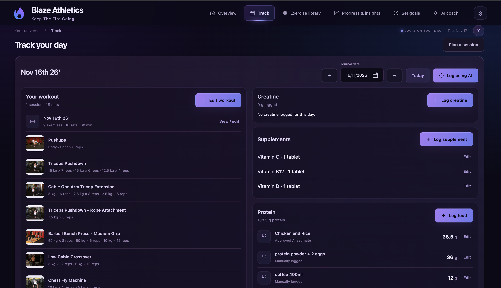
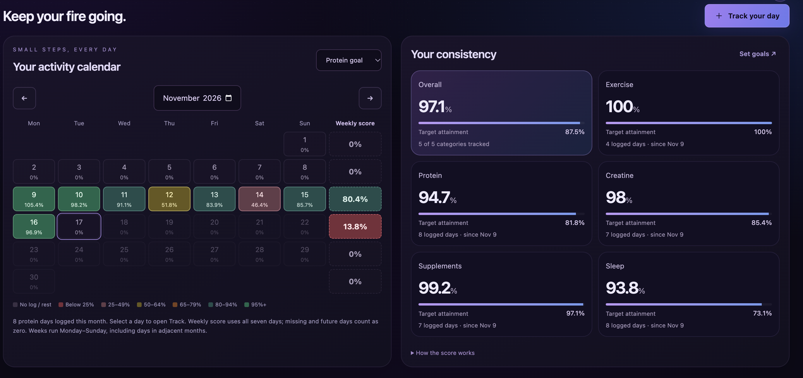
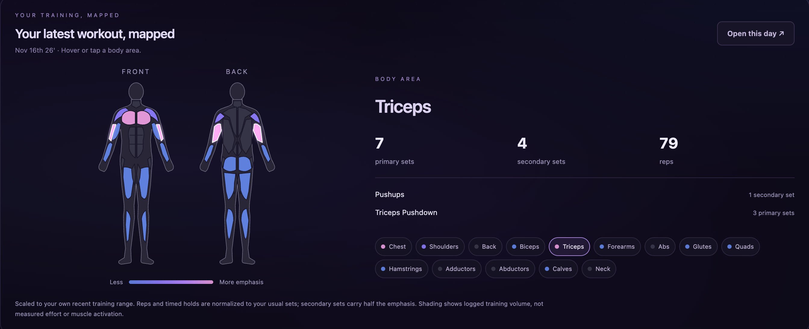
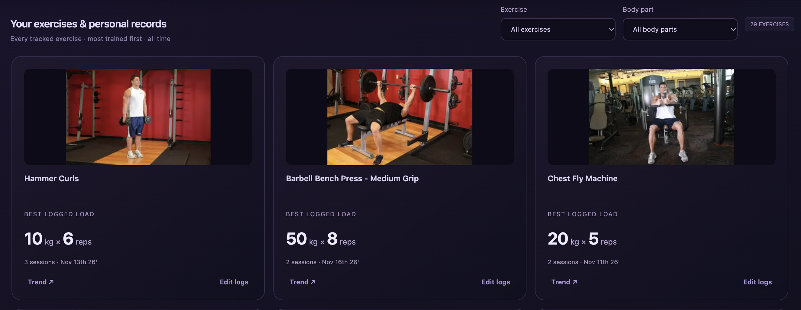
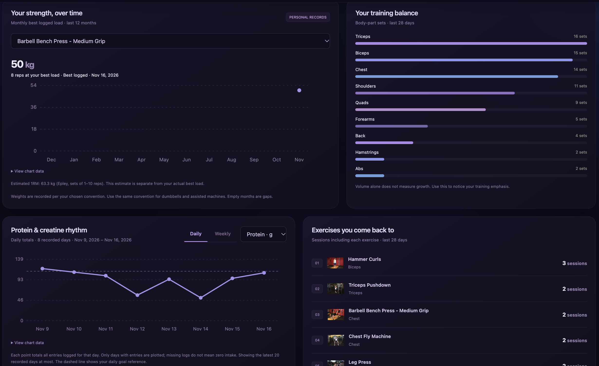
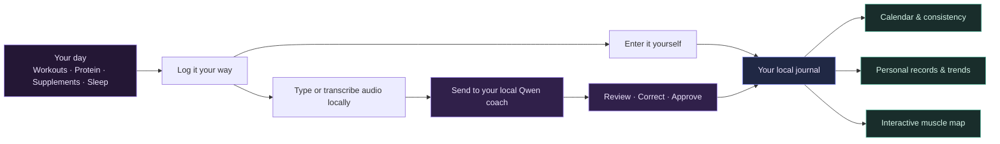

# Blaze Athletics

### Keep the fire going. See what your effort is building.

A fitness journal for the whole day: your workouts, protein, creatine, supplements and sleep, together in one place. See your habits take shape, revisit your best lifts, and work through your next step with a Qwen coach that runs on your own computer.

**Your journal stays local. No account. No API keys.**



## One place for your whole routine

Log each exercise, weight and set—or record time for holds like planks. Keep bodyweight and added weight separate, reuse a previous session, and adjust it to what you actually did. Add your protein, creatine, supplements and sleep alongside the workout. Pick any date to catch up or make a correction.

Changing a set keeps you at the place you're editing. Your journal should help you train, not make you fight the page.

## See your consistency grow

Your calendar brings the daily picture together. Switch between exercise, protein, creatine, supplements and sleep, then look across the weeks. Personal goals give the numbers context, and the six consistency scores help you spot the habits you want to work on next.



## Discover where your training goes

The interactive body map shows the areas involved in your logged workouts. Explore your latest session, a particular day or a week, then select an area to see the exercises and sets behind it.



## Keep your best efforts in view

Browse a library of photographed exercises with instructions and tutorial links. Your personal records bring the exercises you train back into focus: filter by movement or body area, open a trend, or revisit the original log.



## Find the patterns behind your progress

Follow your strength over time and see which movements you return to. Protein and creatine use line charts with **Daily** and **Weekly** views, showing up to the **latest 20 recorded points**. Exact values remain available beneath each chart.



## A coach you can talk to, on your computer

Type your workout or meal, or use the microphone beside **Send** to record your voice. Local speech recognition turns audio into editable text in the message box. Check it, make any corrections, then press **Send**. The local **Qwen** coach can suggest exercise matches, estimate protein, help plan a session, and explain your progress.

Long workout notes are handled in smaller batches. You get a preview to review, correct and approve before anything becomes a saved journal entry. Unclear details stay visible so you can fill them in. A new-chat button gives you a fresh conversation when you need one.

The coach uses **Qwen3 8B through Ollama**. Voice transcription uses **Whisper locally**, with a one-time speech-model download on your first recording. Audio is processed on your computer and is not saved in your journal. You can keep tracking manually whenever the coach is unavailable. Optional **Research** looks up public sources online; ordinary coaching runs locally.

## How it comes together



## Try it on your computer

1. Install [Python 3.10 or newer](https://www.python.org/downloads/) and [Ollama](https://ollama.com/download).
2. Open Ollama. In Terminal, download the recommended coach once:

   ```sh
   ollama pull qwen3:8b
   ```

3. Get the app and start it:

   ```sh
   git clone https://github.com/joshuadominic0598/ai-fitness-tracker-app.git
   cd ai-fitness-tracker-app
   python3 scripts/start.py
   ```

The first start prepares the app, then opens it in your browser. Keep the terminal open while you use it. The initial app setup and model download need internet; everyday journaling and local coaching can run without it afterward. Model speed depends on your computer.

**Next time:** double-click **Start Blaze Athletics.command** on macOS or **Start Blaze Athletics.bat** on Windows. On Linux, run `python3 scripts/start.py` again. On Windows, use `py -3 scripts/start.py` if `python3` isn't available.

**Want to look around first?** Start with `python3 scripts/start.py --demo`. The demo has its own sample journal, separate from your personal records, and doesn't require the coach to be running.

For your first local coaching message, review the short local-processing notice in **AI coach**. If Qwen needs attention, **Settings → Your local Qwen coach** includes a connection test. Your journal opens empty on a fresh clone; the screenshots above show an existing journal.

## Make it yours

Choose goals that suit your routine. Track only what helps you, correct earlier entries, or export a journal backup from Settings. Your records and local settings are excluded from Git, so sharing the project doesn't share your journal.

[Setup help & development](docs/DEVELOPMENT.md) · [Data sources & image credits](docs/DATA_SOURCES.md) · [MIT license](LICENSE)
